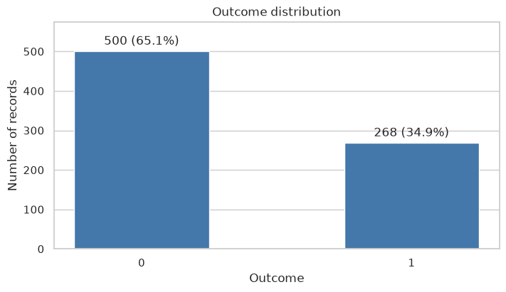
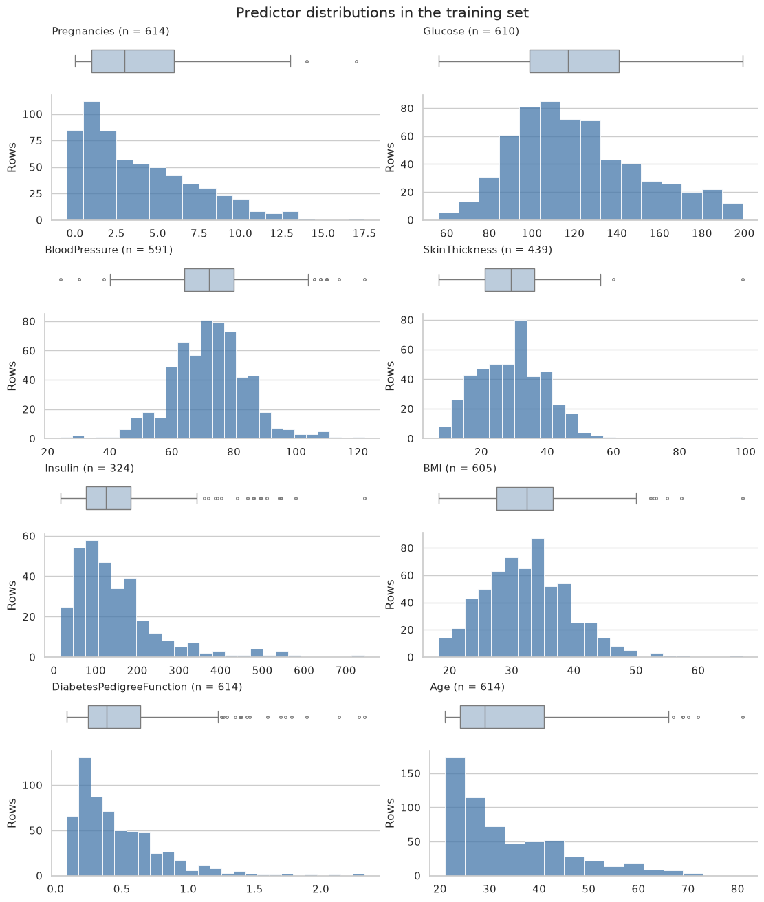
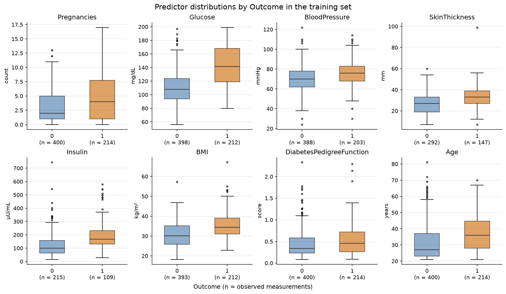
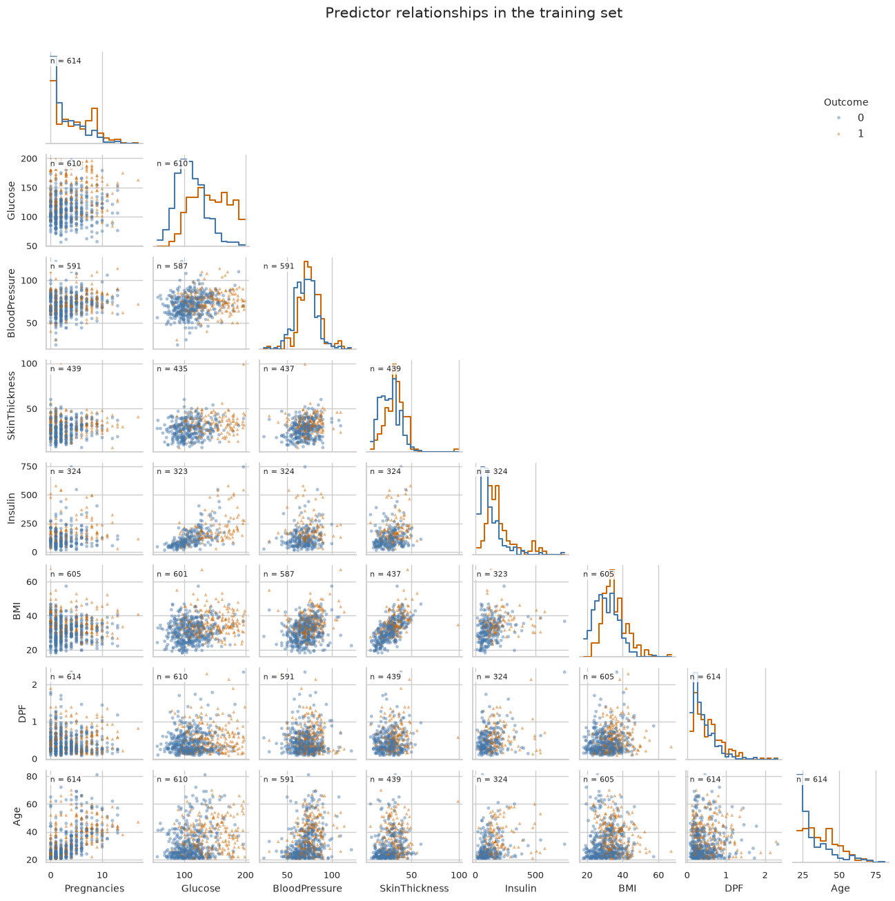
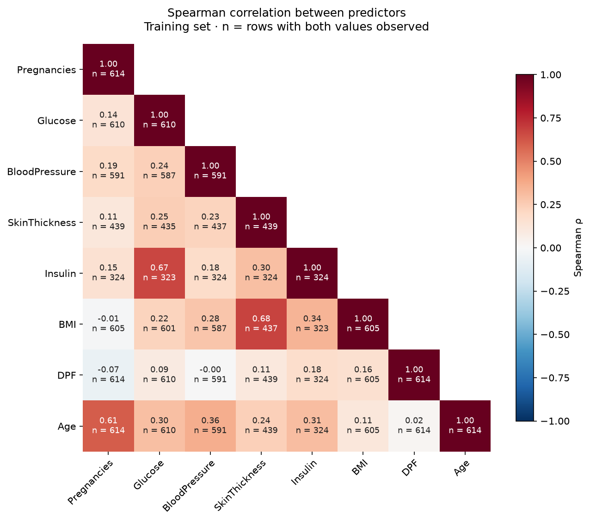
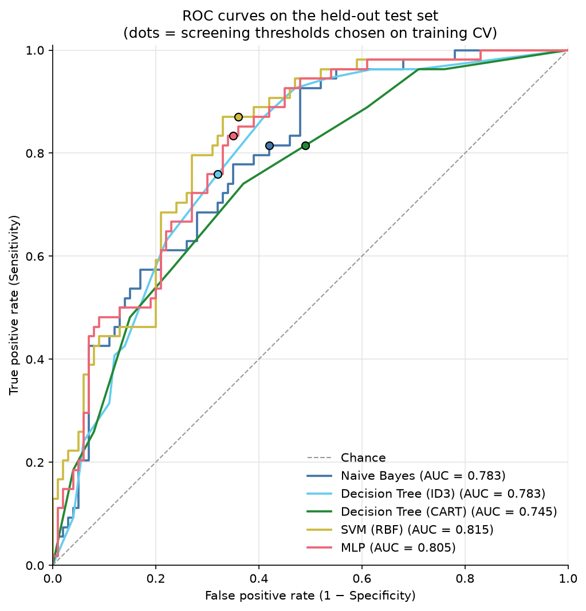
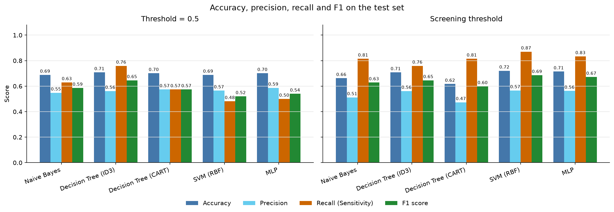
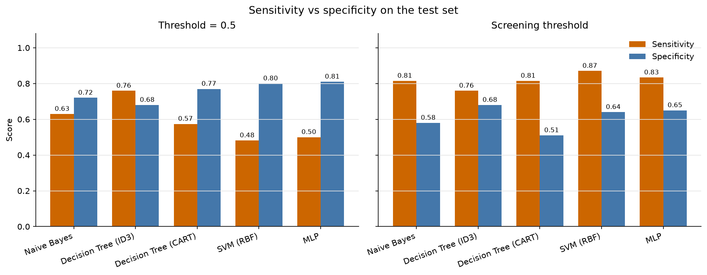
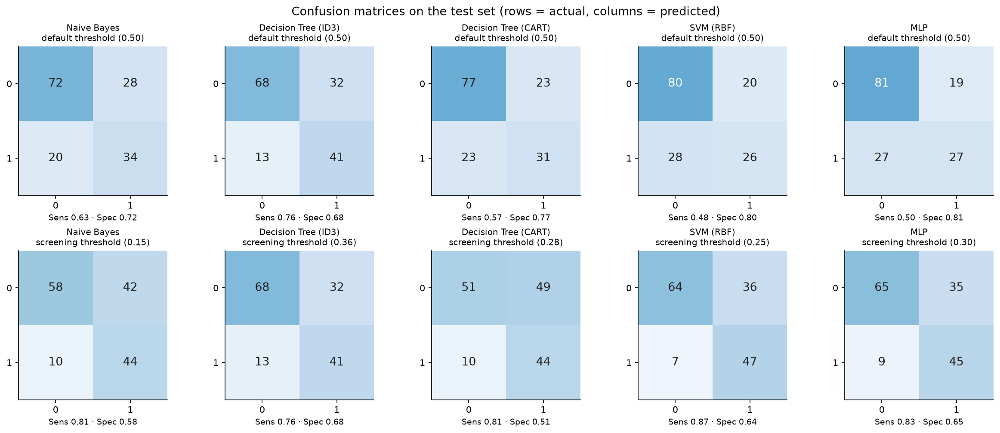
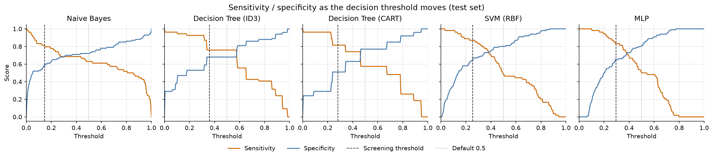

# Đề tài 07: Chẩn đoán Sớm Bệnh lý Mãn tính Đái tháo đường & Tim mạch

> Healthcare Predictive Analytics — Bài tập lớn môn Khai phá dữ liệu (Data Mining)

| Mục | Nội dung |
|---|---|
| Tác vụ khai phá chính | Phân loại y tế (Medical Classification & Risk Scoring) |
| Chuẩn đầu ra (CLO) | L.O.3.2, L.O.4.1, L.O.4.2, L.O.4.3 |
| Tập dữ liệu | Pima Indians Diabetes Database (đã hiện thực) / Heart Disease UCI Dataset |

**Mục tiêu:** sàng lọc nguy cơ mắc bệnh tiểu đường dựa trên các chỉ số sinh hóa và đặc điểm cơ bản, **ưu tiên không bỏ sót người bệnh** (Sensitivity cao).

| Bước | Nội dung | Trạng thái |
|---|---|---|
| 1 | Tiền xử lý: giá trị 0 phi sinh học → missing → KNNImputer, StandardScaler | ✅ |
| 2 | Mô hình hóa: Naive Bayes, Decision Tree (ID3/CART), SVM-RBF, MLP | ✅ |
| 3 | Đánh giá: ROC-AUC, Sensitivity, Specificity | ✅ |
| 4 | Ứng dụng web nhập chỉ số, báo cáo nguy cơ, biểu đồ radar | ⏳ |

---

## Mục lục

0. [Cài đặt & chạy nhanh](#0-cài-đặt--chạy-nhanh)
1. [Lưu trữ dữ liệu](#1-lưu-trữ-dữ-liệu)
2. [EDA — Khám phá dữ liệu](#2-eda--khám-phá-dữ-liệu)
3. [Xử lý dữ liệu](#3-xử-lý-dữ-liệu)
4. [Bước 2 — Xây dựng mô hình](#4-bước-2--xây-dựng-mô-hình)
5. [Bước 3 — Đánh giá](#5-bước-3--đánh-giá)
6. [Reproducibility](#6-reproducibility)
7. [Cấu trúc thư mục](#7-cấu-trúc-thư-mục)

Chi tiết kiến trúc và hiện thực của bước 2–3 nằm trong [model/SPEC.md](model/SPEC.md).

---

## 0. Cài đặt & chạy nhanh

Yêu cầu Python 3.12.

```bash
python3.12 -m venv .venv
.venv/bin/pip install -r requirements.txt

./run_pipeline.sh          # EDA → xử lý dữ liệu → huấn luyện → đánh giá (~40 giây)
```

Hoặc chạy từng bước (từ thư mục gốc repo):

```bash
.venv/bin/python eda_preprocessing/eda.py             # EDA: bảng + biểu đồ
.venv/bin/python eda_preprocessing/preprocessing.py   # Chia train/test, imputation, chuẩn hóa
.venv/bin/python model/train.py                       # Bước 2: tìm siêu tham số + huấn luyện 5 mô hình
.venv/bin/python model/evaluate.py                    # Bước 3: đánh giá trên tập test
```

| Script | Đọc | Ghi |
|---|---|---|
| `eda_preprocessing/eda.py` | `data/raw/diabetes.csv`, `data/raw/train_raw.csv` | `eda_preprocessing/figures/*.png`, `eda_preprocessing/tables/*.csv` |
| `eda_preprocessing/preprocessing.py` | `data/raw/diabetes.csv` | `data/raw/{train,test}_raw.csv`, `data/processed/{train,test}.csv` |
| `model/train.py` | `data/raw/train_raw.csv` | `model/checkpoints/*.joblib`, `model/checkpoints/manifest.json`, `model/reports/cv_results.csv` |
| `model/evaluate.py` | `data/raw/test_raw.csv`, `model/checkpoints/` (qua `model/inference.py`) | `model/reports/test_metrics.csv`, `model/reports/figures/*.png` |

EDA và xử lý dữ liệu dùng **pandas, numpy, matplotlib**; scikit-learn chỉ dùng để chia tập, KNNImputer/StandardScaler và các mô hình.

---

## 1. Lưu trữ dữ liệu

| File | Mô tả |
|---|---|
| `data/raw/diabetes.csv` | File gốc Pima Indians Diabetes ([Kaggle](https://www.kaggle.com/datasets/uciml/pima-indians-diabetes-database)), 768 dòng × 9 cột, **không có header**, giữ nguyên không chỉnh sửa |
| `data/raw/train_raw.csv`, `test_raw.csv` | Split stratified 80/20 (614 / 154 dòng), giá trị 0 phi sinh học đã chuyển thành ô trống (NaN), **chưa** imputation |
| `data/processed/train.csv`, `test.csv` | Sau imputation + chuẩn hóa, sẵn sàng cho mô hình |

`load_pima_csv()` tự nhận biết file có header hay không, kiểm tra đủ 9 cột và `Outcome ∈ {0, 1}` trước khi xử lý.

---

## 2. EDA — Khám phá dữ liệu

Script: [eda_preprocessing/eda.py](eda_preprocessing/eda.py) (chuyển từ notebook `eda.ipynb` trước đây). Biểu đồ lưu ở [eda_preprocessing/figures/](eda_preprocessing/figures/), bảng số liệu ở [eda_preprocessing/tables/](eda_preprocessing/tables/). Từ mục 2.3 trở đi chỉ phân tích **trên tập train**, để tập test không ảnh hưởng tới bất kỳ quyết định nào.

### 2.1. Tổng quan & phân phối nhãn

768 quan sát, 8 biến độc lập dạng số, biến mục tiêu `Outcome`: **500 âm tính (65.1%) và 268 dương tính (34.9%)**. Dữ liệu mất cân bằng vừa phải, nên khi chia tập cần stratify và khi đánh giá không thể chỉ nhìn Accuracy.



### 2.2. Missingness — giá trị 0 phi sinh học

File gốc không có ô trống nào, nhưng 5 chỉ số sinh học lại có giá trị `0`, điều không thể xảy ra ở người sống. Các giá trị này được coi là **missing**. Riêng `Pregnancies = 0` là hợp lệ.

| Biến | Số giá trị 0 → NaN | Tỷ lệ missing |
|---|---|---|
| Glucose | 5 | 0.65% |
| BloodPressure | 35 | 4.56% |
| SkinThickness | 227 | 29.56% |
| Insulin | 374 | **48.70%** |
| BMI | 11 | 1.43% |

Chỉ **392 / 768 dòng** có đủ cả 5 chỉ số, và 227 dòng thiếu đồng thời Insulin lẫn SkinThickness. Nếu xóa các dòng thiếu sẽ mất gần một nửa dữ liệu, nên **bắt buộc phải imputation**. Tỷ lệ thiếu Insulin ở hai lớp xấp xỉ nhau (46.3% so với 49.1%), tức là bản thân việc thiếu không mang nhiều thông tin về nhãn.

### 2.3. Phân phối & outlier (tập train)



- Glucose, BloodPressure và BMI có phân phối gần chuẩn. Insulin, DiabetesPedigreeFunction, Age và Pregnancies **lệch phải** mạnh.
- Số điểm nằm ngoài khoảng 1.5×IQR: DPF 19, Insulin 17, BloodPressure 13, BMI 6, Age 6. Đây là các giá trị cực đoan nhưng vẫn **hợp lý về mặt sinh học** (ví dụ Insulin 744 µU/mL), nên được **giữ lại**.

### 2.4. Biến độc lập theo `Outcome`



| Biến | Median (Outcome = 0) | Median (Outcome = 1) |
|---|---|---|
| **Glucose** | 108.0 | **141.5** |
| Insulin | 100.0 | 168.0 |
| Age | 27 | 36 |
| BMI | 30.1 | 34.35 |
| Pregnancies | 2 | 4 |
| SkinThickness | 27 | 33 |
| BloodPressure | 70 | 76 |
| DPF | 0.34 | 0.46 |

Tất cả các biến đều dịch lên ở nhóm bệnh. **Glucose phân tách hai lớp rõ nhất**, đúng với cơ chế bệnh sinh của đái tháo đường.

### 2.5. Quan hệ giữa các biến





Có ba cặp tương quan Spearman đáng kể: **BMI – SkinThickness (0.68)**, **Glucose – Insulin (0.67)**, **Age – Pregnancies (0.61)**; các cặp còn lại đều ≤ 0.36. Điều này cho thấy:

- Biến thiếu nhiều (SkinThickness, Insulin) lại tương quan mạnh với biến gần như đầy đủ (BMI, Glucose). Đây là cơ sở để chọn **KNNImputer**: ước lượng giá trị thiếu từ những bệnh nhân "giống nhau" ở các chỉ số còn lại.
- Không có cặp nào tương quan gần 1, nên giữ lại cả 8 biến.

---

## 3. Xử lý dữ liệu

Script: [eda_preprocessing/preprocessing.py](eda_preprocessing/preprocessing.py)

```
diabetes.csv
   │  load_pima_csv()          kiểm tra schema, gán tên cột
   ▼
   │  prepare_predictors()     0 → NaN ở Glucose, BloodPressure, SkinThickness, Insulin, BMI
   ▼
   │  train_test_split         stratify = Outcome, test_size = 0.2, random_state = 42
   ▼
train_raw.csv (614)   test_raw.csv (154)          ← vẫn còn NaN
   │                      │
   │  fit                 │  transform
   ▼                      ▼
StandardScaler  →  KNNImputer(n_neighbors = 5)
   ▼                      ▼
train.csv              test.csv                   ← đã điền đủ, z-score
```

- **Chia tập trước khi imputation** để tránh rò rỉ dữ liệu: mean, std và láng giềng KNN chỉ được học từ tập train.
- **Chuẩn hóa trước, imputation sau**: KNNImputer dùng khoảng cách Euclid, nên nếu không chuẩn hóa, các biến có thang đo lớn như Insulin (15–744) sẽ lấn át DPF (0.08–2.33). `StandardScaler` bỏ qua NaN khi fit nên thứ tự này thực hiện được.
- Toàn bộ chuỗi trên được đóng gói trong `build_preprocessor()` và **được dùng lại nguyên vẹn bên trong pipeline của từng mô hình** ở bước 2.

---

## 4. Bước 2 — Xây dựng mô hình

Script: [model/train.py](model/train.py) · Chi tiết: [model/SPEC.md §2–3](model/SPEC.md)

**Kiến trúc.** Mỗi mô hình là một pipeline `preprocess (bước 1) → classifier`, nhận **chỉ số thô** và trả về **xác suất mắc bệnh**. Nhờ vậy khi cross-validation, imputer và scaler được fit lại trong từng fold, không bị leakage. Sau khi refit trên toàn bộ tập train, bộ tiền xử lý trùng khớp tuyệt đối với `data/processed/`; `evaluate.py` có kiểm tra điều này.

| Mô hình | Hiện thực | Tham số tốt nhất |
|---|---|---|
| Naive Bayes | `GaussianNB` | `var_smoothing = 1e-12` |
| Decision Tree **ID3** | `DecisionTreeClassifier(criterion="entropy")` (Information Gain) | `max_depth = 6, min_samples_leaf = 20, class_weight = balanced` |
| Decision Tree **CART** | `DecisionTreeClassifier(criterion="gini")` | `max_depth = 5, min_samples_leaf = 40, class_weight = balanced` |
| SVM kernel **RBF** | `SVC(kernel="rbf")` + Platt calibration (`CalibratedClassifierCV`) | `C = 30, gamma = 0.003, class_weight = balanced` |
| **MLP** | `MLPClassifier` (Adam, ReLU) | `hidden = (16, 8), alpha = 3.0, lr = 0.001` |

**Quy trình huấn luyện:**

1. `GridSearchCV` trên 11–84 cấu hình mỗi mô hình, **Stratified 5-fold CV**, chọn theo **ROC-AUC**.
2. **Chọn ngưỡng sàng lọc t\*** từ xác suất out-of-fold trên train: lấy ngưỡng cao nhất mà **Sensitivity ≥ 0.85**, tức là giữ Specificity cao nhất có thể.
3. Lưu **checkpoint** của từng mô hình vào `model/checkpoints/<model>.joblib`, kèm `manifest.json` (ngưỡng t\*, tham số, điểm CV, mô hình mặc định, danh sách cột đầu vào, phiên bản thư viện).

**Checkpoint & inference.** Backend không cần biết chi tiết huấn luyện, chỉ cần gọi [model/inference.py](model/inference.py):

```python
import sys; sys.path.insert(0, "<thư mục gốc repo>")
from model.inference import load_model

model = load_model()            # mô hình mặc định trong manifest (MLP); hoặc load_model("svm_rbf")
model.predict({"Pregnancies": 6, "Glucose": 148, "BloodPressure": 72, "Insulin": 0,
               "BMI": 33.6, "DiabetesPedigreeFunction": 0.627, "Age": 50})
# [{"model": "mlp", "probability": 0.63, "threshold": 0.296, "high_risk": true,
#   "imputed_fields": ["SkinThickness", "Insulin"], ...}]
```

Hướng dẫn đầy đủ (đầu vào, đơn vị, cách đọc kết quả, chọn mô hình, ví dụ Flask, xử lý lỗi): **[model/checkpoints/README.md](model/checkpoints/README.md)**.

Thử nhanh bằng dòng lệnh: `.venv/bin/python model/inference.py --list` hoặc `.venv/bin/python model/inference.py '{"Glucose": 148, "BMI": 33.6, "Age": 50}'`.

Kết quả trên tập train. Các chỉ số phân loại tính từ dự đoán out-of-fold (OOF) tại ngưỡng t\*:

| Mô hình | CV ROC-AUC | Ngưỡng t\* | Accuracy | Precision | Recall (Sens.) | F1 | Specificity |
|---|---|---|---|---|---|---|---|
| Naive Bayes | 0.831 ± 0.009 | 0.147 | 0.721 | 0.567 | 0.855 | 0.682 | 0.650 |
| Decision Tree (ID3) | 0.814 ± 0.021 | 0.360 | 0.708 | 0.552 | 0.864 | 0.674 | 0.625 |
| Decision Tree (CART) | 0.807 ± 0.008 | 0.281 | 0.630 | 0.483 | 0.860 | 0.618 | 0.508 |
| SVM (RBF) | 0.850 ± 0.010 | 0.254 | 0.710 | 0.555 | 0.850 | 0.672 | 0.635 |
| **MLP** | **0.854 ± 0.009** | 0.296 | **0.738** | **0.585** | 0.850 | **0.693** | **0.678** |

Chỉ số OOF ở ngưỡng 0.5 có trong [model/reports/cv_results.csv](model/reports/cv_results.csv).

---

## 5. Bước 3 — Đánh giá

Script: [model/evaluate.py](model/evaluate.py) · Kết quả đầy đủ: [model/reports/test_metrics.csv](model/reports/test_metrics.csv)

Đánh giá **một lần duy nhất** trên 154 dòng test hold-out (54 ca dương tính), ở hai ngưỡng: mặc định 0.5 và ngưỡng sàng lọc t\* đã chọn ở bước 2. Khoảng tin cậy 95% của AUC tính bằng bootstrap 1000 lần.

**ROC-AUC** (không phụ thuộc ngưỡng):

| Naive Bayes | Decision Tree (ID3) | Decision Tree (CART) | SVM (RBF) | MLP |
|---|---|---|---|---|
| 0.783 [0.708, 0.850] | 0.783 [0.706, 0.851] | 0.745 [0.658, 0.822] | **0.815** [0.745, 0.876] | 0.805 [0.733, 0.868] |

**Các chỉ số phân loại** (Recall chính là Sensitivity; FN là số người bệnh bị bỏ sót trên tổng 54):

| Mô hình | Ngưỡng | Accuracy | Precision | Recall (Sens.) | F1 | Specificity | FN |
|---|---|---|---|---|---|---|---|
| Naive Bayes | 0.5 | 0.688 | 0.548 | 0.630 | 0.586 | 0.720 | 20 |
| | t\* = 0.147 | 0.662 | 0.512 | 0.815 | 0.629 | 0.580 | 10 |
| Decision Tree (ID3) | 0.5 | 0.708 | 0.562 | 0.759 | 0.646 | 0.680 | 13 |
| | t\* = 0.360 | 0.708 | 0.562 | 0.759 | 0.646 | 0.680 | 13 |
| Decision Tree (CART) | 0.5 | 0.701 | 0.574 | 0.574 | 0.574 | 0.770 | 23 |
| | t\* = 0.281 | 0.617 | 0.473 | 0.815 | 0.599 | 0.510 | 10 |
| SVM (RBF) | 0.5 | 0.688 | 0.565 | 0.481 | 0.520 | 0.800 | 28 |
| | t\* = 0.254 | **0.721** | 0.566 | **0.870** | **0.686** | 0.640 | **7** |
| **MLP** | 0.5 | 0.701 | **0.587** | 0.500 | 0.540 | **0.810** | 27 |
| | t\* = 0.296 | 0.714 | 0.562 | 0.833 | 0.672 | 0.650 | 9 |











**Kết luận:**

- **SVM-RBF và MLP tốt nhất** (test AUC 0.815 / 0.805), CART kém nhất (0.745). Tuy nhiên khoảng tin cậy chồng lấn nhiều vì tập test nhỏ, nên chênh lệch giữa 4 mô hình đầu chưa có ý nghĩa thống kê.
- **Ngưỡng 0.5 bỏ sót tới 50% người bệnh.** Sau khi chuyển sang ngưỡng sàng lọc t\*, Sensitivity trên test đạt **0.81–0.87**, khớp với mục tiêu 0.85 đặt trên train. Số ca bỏ sót giảm 2–4 lần, đổi lại Specificity giảm khoảng 0.15. Với bài toán sàng lọc, đây là đánh đổi chấp nhận được: ca dương tính giả sẽ được xét nghiệm khẳng định (HbA1c/OGTT).
- **F1 và Accuracy cũng không giảm khi hạ ngưỡng.** Với SVM và MLP, F1 tăng từ 0.52–0.54 lên 0.67–0.69, Accuracy giữ nguyên hoặc tăng nhẹ (0.69–0.70 → 0.71–0.72). Lý do: Recall tăng mạnh trong khi Precision gần như không đổi (≈ 0.56). Precision ≈ 0.56 có nghĩa là khoảng 44% số ca bị cảnh báo thực ra không bệnh, mức chấp nhận được cho sàng lọc ban đầu.
- **Accuracy không phù hợp làm tiêu chí chính.** Một mô hình luôn đoán "không bệnh" cũng đạt Accuracy 0.649 (100/154) mà không phát hiện được ai. Vì vậy báo cáo ưu tiên ROC-AUC và Recall/Sensitivity, dùng F1 để cân bằng với Precision.
- **Mô hình đề xuất cho app (bước 4): MLP @ t\* = 0.296**, được chọn theo CV AUC trên train chứ không theo test. Trên test, mô hình phát hiện 45/54 ca bệnh với NPV 0.878. SVM-RBF là phương án thay thế ngang hàng.

Phân tích chi tiết (vì sao SVM `balanced` vẫn có Sensitivity thấp ở ngưỡng 0.5, vì sao ID3 không đổi khi thay ngưỡng, hạn chế của nghiên cứu...) nằm trong [model/SPEC.md §5](model/SPEC.md).

---

## 6. Reproducibility

- Mọi nguồn ngẫu nhiên đều cố định `random_state = 42`: chia tập, CV fold, DecisionTree, SVC, MLP, bootstrap.
- Phiên bản thư viện được pin trong [requirements.txt](requirements.txt).
- Đã kiểm chứng: chạy `run_pipeline.sh` hai lần cho `manifest.json`, `cv_results.csv`, `test_metrics.csv` và các bảng EDA **giống nhau từng byte**.
- `manifest.json` ghi lại phiên bản scikit-learn đã dùng để lưu checkpoint; `load_model()` cảnh báo nếu môi trường chạy backend dùng phiên bản khác.
- `evaluate.py` kiểm tra bộ tiền xử lý đã lưu tái tạo đúng `data/processed/test.csv`; sai lệch sẽ làm script dừng với lỗi.

---

## 7. Cấu trúc thư mục

```
.
├── README.md                    # Báo cáo này
├── requirements.txt             # Thư viện (pin phiên bản)
├── run_pipeline.sh              # Chạy toàn bộ pipeline
│
├── data/
│   ├── raw/                     # diabetes.csv gốc + train_raw/test_raw (split, còn NaN)
│   └── processed/               # train.csv / test.csv đã imputation + chuẩn hóa
│
├── eda_preprocessing/           # Bước 1
│   ├── eda.py                   #   EDA → figures/ + tables/
│   ├── preprocessing.py         #   Split, 0 → NaN, StandardScaler, KNNImputer
│   ├── figures/                 #   5 biểu đồ EDA
│   └── tables/                  #   Bảng missingness, thống kê mô tả, tương quan
│
├── model/                       # Bước 2 + 3
│   ├── SPEC.md                  #   Đặc tả kiến trúc, hiện thực, kết quả
│   ├── train.py                 #   GridSearchCV + chọn ngưỡng sàng lọc
│   ├── evaluate.py              #   Đánh giá trên test + biểu đồ
│   ├── inference.py             #   API load checkpoint + dự đoán (dùng cho backend)
│   ├── checkpoints/             #   5 checkpoint .joblib + manifest.json + README (hướng dẫn sử dụng)
│   └── reports/                 #   cv_results.csv, test_metrics.csv, figures/
│
└── app/                         # Bước 4 — Flask API và giao diện web
    ├── backend/
    └── frontend/
```

## Thành viên nhóm

| Họ tên | MSSV | Phụ trách |
|---|---|---|
| | | |
